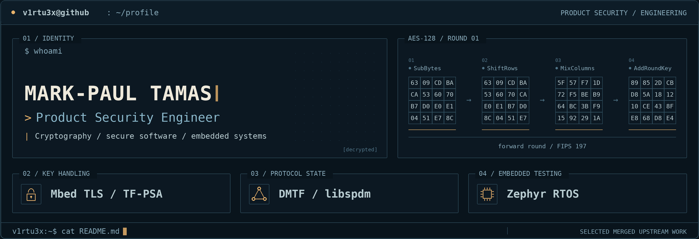

<picture>
  <source media="(max-width: 640px) and (prefers-reduced-motion: reduce) and (prefers-color-scheme: light)" srcset="assets/header-light-mobile.png">
  <source media="(max-width: 640px) and (prefers-reduced-motion: reduce)" srcset="assets/header-dark-mobile.png">
  <source media="(prefers-reduced-motion: reduce) and (prefers-color-scheme: light)" srcset="assets/header-light.png">
  <source media="(prefers-reduced-motion: reduce)" srcset="assets/header-dark.png">
  <source media="(max-width: 640px) and (prefers-color-scheme: light)" srcset="assets/header-light-mobile.png">
  <source media="(max-width: 640px)" srcset="assets/header-dark-mobile.png">
  <source media="(prefers-color-scheme: light)" srcset="assets/header-light.png">
  
</picture>

## `01 / profile`

I'm **Mark-Paul Tamas**, a **Product Security Engineer** working across security architecture, threat modeling and risk assessment, vulnerability assessment, and secure software engineering. My professional experience spans automotive, industrial/OT, and medical-device security contexts.

I'm particularly interested in where architecture meets implementation: cryptographic key handling, protocol state management, embedded software, and reproducible security testing.

## `02 / merged upstream work`

**Mbed TLS / TF-PSA-Crypto** · `cryptographic key handling`  
Fixed missing zeroization of sensitive shared-secret material in `psa_key_agreement()` across return paths.  
[Merged fix](https://github.com/Mbed-TLS/TF-PSA-Crypto/pull/886) · [1.1 backport](https://github.com/Mbed-TLS/TF-PSA-Crypto/pull/890)

**DMTF / libspdm** · `protocol security`  
Fixed stale peer DIGESTS and pending-request state retained by `libspdm_reset_context()`, including cached request data, and added regression coverage.  
[Merged fix](https://github.com/DMTF/libspdm/pull/4199)

**Zephyr RTOS** · `embedded software and testing`  
Added 11 regression tests for Bluetooth Host key-pool behavior and persisted-key loading. Also improved `ROM_START_OFFSET` defaults for Cortex-M vector-table alignment in MCUboot configurations.  
[Bluetooth tests](https://github.com/zephyrproject-rtos/zephyr/pull/122133) · [Boot configuration](https://github.com/zephyrproject-rtos/zephyr/pull/120785)

## `03 / published research`

**[A Comparative Entropy Analysis of BJT Avalanche Noise, SDR Noise and Algorithmic PRNGs](https://ieeexplore.ieee.org/document/11583673)**  
IEEE · 2026  
Experimental analysis of physical-noise and algorithmic randomness sources.

**[Threat Analysis and Risk Assessment of the Takeover Request Component in Advanced Driver Assistance Systems for SAE Level 2–3](https://doi.org/10.3390/electronics15112446)**  
*Electronics* · 2026  
Cybersecurity analysis of automated-driving handover functions.

**[Threat Analysis and Risk Assessment (TARA) of an Autonomous Emergency Braking (AEB) System](https://doi.org/10.3390/app15031400)**  
*Applied Sciences* · 2025  
Threat modeling and risk assessment of a safety-critical automotive function.

## `04 / connect`

[LinkedIn](https://www.linkedin.com/in/mark-paul-tamas-7a77b0264/) · [Merged pull requests](https://github.com/search?q=author%3Av1rtu3x+is%3Apr+is%3Amerged&type=pullrequests)

[Animated version](README.md)
